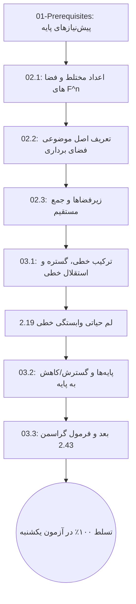

---
tags:
  - MOC
  - نقشه_راه
  - جبر_خطی
  - آکسلر
  - برنامه_مطالعاتی
---
 # 🗺️ نقشه راه جامع و پایگاه دانش اتمیک جبر خطی آکسلر (فصل ۱ و ۲)

> [!TLDR] قطب‌نمای مطالعه و تسلط ۱۰۰٪
> این مخزن بر اساس کتاب مرجع **Linear Algebra Done Right (ویرایش چهارم، ۲۰۲۴)** اثر **شلدون آکسلر** و ترجمه فارسی **دکتر مهدی نجفی‌خواه** طراحی شده است. تمام مفاهیم، قضایا، تعاریف، اثبات‌ها و تمرین‌های **فصل ۱ (صفحات ۱۲ تا ۳۹)** و **فصل ۲ (صفحات ۴۰ تا ۶۸)** به یادداشت‌های اتمیک مستقل، پیوسته و شهودی با رعایت کامل اصول **RTL**، فرمول‌های دقیق **LaTeX**، کادرهای استاندارد **Callout** و شبیه‌سازی‌های تعاملی **GeoGebra Lab** تبدیل شده‌اند تا حتی بدون پیش‌زمینه قوی دانشگاهی، به تسلط کامل برسید.

---

## ⚡ پیوندهای استراتژیک سریع
* 📅 **برنامه اقدام اضطراری تا آزمون یکشنبه:** [[06-برنامه جامع مطالعاتی و جمع‌بندی فشرده]]
* 🧱 **فهرست مفاهیم پیش‌نیاز پایه:** [[01-MOC پیش‌نیازهای ریاضی]]
* 📘 **ورود به مباحث فصل ۱ (فضاهای برداری):** [[02-MOC فصل ۱ - فضاهای برداری]]
* 📙 **ورود به مباحث فصل ۲ (فضاهای با بعد متناهی):** [[03-MOC فصل ۲ - فضاهای برداری با بعد متناهی]]
* ✍️ **بانک جامع حل تشریحی تمرینات:** [[04-MOC حل تمرینات جبر خطی]]
* 📐 **گالری شبیه‌سازهای تعاملی:** [[00-نقشه‌های راه/05-MOC تجسم‌های هندسی جئوجبرا|MOC تجسم‌های هندسی جئوجبرا]]
* 📐 **الگوهای استاندارد تولید محتوا:** [[Templates/الگوی یادداشت پیش‌نیاز|الگوهای اتمیک]]

---

## 🗂️ ساختار مخزن دانشی و پوشه‌بندی (Vault Architecture)

| مسیر پوشه | شرح محتوا و اهداف | تعداد یادداشت‌ها |
| :--- | :--- | :---: |
| `00-MOCs/` | نقشه‌های راه، برنامه‌ریزی مطالعاتی و راهنماهای اصلی مخزن | ۷ |
| `01-Prerequisites/` | مفاهیم پیش‌نیاز ریاضی دبیرستانی و پایه‌های ضروری | ۱۱ |
| `02-Chapter-1/` | **فصل اول: فضاهای برداری** | **۴۶** |
| `├─ 02.1-Rn-and-Cn/` | بخش ۱.۱: فضاها و خواص جبری اعداد مختلط و حقیقی | ۱۸ |
| `├─ 02.2-Vector-Spaces/` | بخش ۲.۱: اصول موضوعه دهگانه و خواص پایه فضای برداری | ۱۴ |
| `└─ 02.3-Subspaces-and-Direct-Sums/` | بخش ۳.۱: زیرفضاها، جمع زیرفضاها و جمع مستقیم | ۱۴ |
| `03-Chapter-2/` | **فصل دوم: فضاهای با بعد متناهی** | **۴۱** |
| `├─ 03.1-Span-and-Linear-Independence/` | بخش ۱.۲: گستره (Span)، استقلال و لم وابستگی خطی | ۲۴ |
| `├─ 03.2-Bases/` | بخش ۲.۲: پایه‌ها، الگوریتم کاهش و قضیه گسترش | ۷ |
| `└─ 03.3-Dimension/` | بخش ۳.۲: بعد، ابعاد زیرفضاها و فرمول گراسمن | ۱۰ |
| `04-Exercises/` | **بانک جامع حل تشریحی تمرینات پایان بخش‌ها** | **۹۸** |
| `├─ 04.1-Chapter-1/` | حل تشریحی تمرین‌های فصل اول (بخش‌های ۱.۱، ۲.۱، ۳.۱) | ۴۷ |
| `└─ 04.2-Chapter-2/` | حل تشریحی تمرین‌های فصل دوم (بخش‌های ۱.۲، ۲.۲، ۳.۲) | ۵۱ |
| `Templates/` | قالب‌های پنج‌گانه استاندارد یادداشت‌های اتمیک ابسیدین | ۵ |

---

## 🧭 درخت دانش و توالی منطقی مطالعه (Learning Trajectory)

---

## 🎯 اهداف یادگیری و خروجی‌های تضمین‌شده
1. **درک مفهومی بدون ابهام:** تمامی مفاهیم انتزاعی با مثال‌های روزمره و تعبیرهای تصویری آغاز می‌شوند.
2. **تسلط بر تکنیک‌های اثبات:** آموزش روش‌های استاندارد اثبات آکسلر (استفاده از لم وابستگی خطی، یکتایی نمایش بردار صفر برای جمع مستقیم، ساخت پایه‌ها با بسط و کاهش).
3. **مهارت حل مسئله:** تسلط بر حل گام‌به‌گام سوالات امتحانی به همراه شناخت دام‌های تستی و تشریحی.
