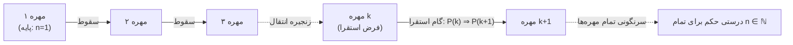

---
tags:
  - پیش‌نیاز
  - جبر_پایه
  - جبر_خطی
  - استقرای_ریاضی
  - روش‌های_اثبات
---
# پیش‌نیاز: استقرای ریاضی و کاربرد آن در جبر خطی

> [!TLDR] خلاصه شهودی در یک جمله
> اصل استقرای ریاضی شبیه چیدن ردیفی از مهره‌های دومینو است؛ اگر مطمئن شوید مهره اول می‌افتد (پایه) و افتادن هر مهره تضمین کند مهره بعدی هم خواهد افتاد (گام استقرا)، آنگاه تمامی مهره‌ها تا بی‌نهایت فرو خواهند ریخت؛ در جبر خطی از این تکنیک برای اثبات قضایا روی «طول لیست بردارها» یا «بُعد فضا» استفاده می‌شود.

---

## ۱. انگیزه و ضرورت در جبر خطی
* **چرا این مفهوم را در کتاب آکسلر می‌بینیم و بدون آن به بن‌بست می‌خوریم؟**
  فصل ۲ کتاب شلدون آکسلر عنوان مهم **«فضاهای با بعد متناهی» (Finite-Dimensional Vector Spaces)** را بر پیشانی دارد. واژه «متناهی» یعنی بعد فضا یا طول لیست بردارها یک عدد صحیح مانند $n$ یا $m$ است.
  وقتی آکسلر می‌خواهد قضایای بنیادینی مانند:
  - **لم وابستگی خطی (Linear Dependence Lemma ۲.۲۱):** حذف یک بردار وابسته از لیست بدون تغییر در گستره.
  - **قضیه کاهش لیست مولد (۲.۳۱):** هر لیست مولد را می‌توان با حذف اعضای اضافه به یک «پایه» تبدیل کرد.
  - **قضیه تعمیم لیست مستقل (۲.۳۳):** هر لیست ناوابسته خطی را می‌توان با افزودن بردار به یک «پایه» گسترش داد.
  - **قضیه اصلی بعد (۲.۲۳):** طول هر لیست مستقل خطی کمتر یا مساوی طول هر لیست مولد است.
  را اثبات کند، دقیقاً از **الگوریتم‌های گام‌به‌گام استقرایی روی طول لیست بردارها** استفاده می‌کند! اگر روش استنتاج استقرایی را نشناسید، این اثبات‌ها مثل شعبده‌بازی به نظر می‌رسند.
* **مفاهیم متصل در کتاب:**
  - [[03-Chapter-2/03.1-Span-and-Linear-Independence/لم ۱۹.۲ لم وابستگی خطی (Linear Dependence Lemma)|لم ۲۱.۲: لم وابستگی خطی (مهم‌ترین موتور محرک کتاب)]]
  - [[03-Chapter-2/03.2-Bases/قضیه ۲۹.۲ هر لیست مولد شامل یک پایه است (کاهش به پایه)|قضیه ۳۱.۲: الگوریتم گام‌به‌گام استقرایی ساخت پایه]]
  - [[03-Chapter-2/03.2-Bases/قضیه ۳۱.۲ هر لیست مستقل خطی می‌تواند به یک پایه گسترش یابد|قضیه ۳۳.۲: تعمیم لیست مستقل به پایه]]
  - [[01-Prerequisites/نماد سیگما و ترکیبات خطی در دبیرستان|پیش‌نیاز ۹: نماد سیگما و ترکیبات خطی]]

---

## ۲. درک شهودی و تصویرسازی ذهنی

ردیفی بی‌پایان از مهره‌های دومینو را تصور کنید که در یک خط مستقیم چیده شده‌اند:

برای اینکه مطمئن شوید همه مهره‌ها تا آخرین دانه سرنگون خواهند شد، نیازی نیست بروید و تک‌تک آن‌ها را با دست هل بدهید! فقط کافی است دو شرط را بررسی کنید:
1. **پایه استقرا (Base Case):** آیا دست شما اولین مهره را هل می‌دهد؟ (آیا حکم برای $n=1$ درست است؟)
2. **گام استقرا (Inductive Step):** آیا فاصله بین هر دو مهره متوالی آن‌قدر مناسب هست که اگر مهره شماره $k$ سقوط کرد، حتماً تنه بزند و مهره شماره $k+1$ را بیندازد؟ ($P(k) \implies P(k+1)$).

اگر این دو شرط برقرار باشند، زنجیره واکنش آغاز می‌شود: مهره ۱ مهره ۲ را می‌اندازد، مهره ۲ مهره ۳ را، و این فرآیند هرگز متوقف نمی‌شود!

---

## ۳. تعریف دقیق و فرمول‌بندی ریاضی

> [!DEFINITION] اصل استقرای ریاضی (Principle of Mathematical Induction)
> فرض کنید $P(n)$ گزاره‌ای درباره عدد طبیعی $n$ باشد. اگر:
> ۱. **پایه استقرا:** $P(1)$ درست باشد.
> ۲. **گام استقرا:** به ازای هر $k \ge 1$، با فرض درستی $P(k)$ (که آن را **فرض استقرا** می‌نامیم)، درستی $P(k+1)$ نتیجه شود:
>    $$\forall k \ge 1: \quad P(k) \implies P(k+1)$$
> 
> آنگاه گزاره $P(n)$ به ازای تمامی اعداد طبیعی $n \in \{1, 2, 3, \dots\}$ برقرار است.

> [!DEFINITION] استقرای قوی (Strong Induction)
> در برخی اثبات‌های جبر خطی (مانند تجزیه به زیرفضاهای ناوردا)، فرض استقرا را قوی‌تر در نظر می‌گیریم:
> «فرض می‌کنیم حکم برای تمامی مقادیر $1, 2, \dots, k$ درست باشد؛ سپس درستی آن را برای $k+1$ اثبات می‌کنیم.»

---

## ۴. مثال‌های عددی و اثبات گام‌به‌گام

> [!EXAMPLE] مثال ۱: اثبات یک اتحاد معروف با استقرای ریاضی
> **مسئله:** اثبات کنید برای هر $n \ge 1$:
> $$1 + 2 + 3 + \dots + n = \frac{n(n+1)}{2}$$
> 
> **حل گام‌به‌گام:**
> ۱. **پایه استقرا ($n=1$):**
>    - سمت چپ: $1$
>    - سمت راست: $\frac{1(1+1)}{2} = \frac{2}{2} = 1$
>    چون دو طرف برابرند ($1 = 1$)، پایه برقرار است.
> 
> ۲. **فرض استقرا ($n=k$):**
>    فرض می‌کنیم تساوی برای $n=k$ صادق باشد:
>    $$1 + 2 + \dots + k = \frac{k(k+1)}{2}$$
> 
> ۳. **گام استقرا ($n=k+1$):**
>    باید نشان دهیم:
>    $$1 + 2 + \dots + k + (k+1) \overset{?}{=} \frac{(k+1)((k+1)+1)}{2} = \frac{(k+1)(k+2)}{2}$$
>    سمت چپ را با استفاده از **فرض استقرا** بازنویسی می‌کنیم:
>    $$\underbrace{(1 + 2 + \dots + k)}_{\text{طبق فرض استقرا}} + (k+1) = \frac{k(k+1)}{2} + (k+1)$$
>    از فاکتور مشترک $(k+1)$ فاکتور می‌گیریم:
>    $$= (k+1) \left( \frac{k}{2} + 1 \right) = (k+1) \left( \frac{k + 2}{2} \right) = \frac{(k+1)(k+2)}{2}$$
>    سمت راست عیناً حاصل شد! حکم برای تمام $n \in \mathbb{N}$ اثبات شد.

> [!EXAMPLE] پیش‌نمایش کاربرد در جبر خطی (اثبات روی طول لیست بردارها)
> فرض کنید می‌خواهیم نشان دهیم اگر $v_1 \neq 0$ باشد و هر بردار جدید $v_j$ در گستره برداران قبلی نباشد، لیست مستقل خطی است:
> - **پایه استقرا ($m=1$):** یک بردار غیرصفر $\{v_1\}$ به وضوح مستقل خطی است (زیرا $c_1 v_1 = 0 \implies c_1 = 0$).
> - **گام استقرا ($m=k+1$):** فرض می‌کنیم لیست $(v_1, \dots, v_k)$ مستقل خطی باشد. حال اگر $c_1 v_1 + \dots + c_k v_k + c_{k+1} v_{k+1} = 0$ باشد:
>   اگر $c_{k+1} \neq 0$ باشد، می‌توان $v_{k+1}$ را بر حسب برداران قبلی نوشت (تناقض با فرض که در گستره قبلی‌ها نیست). پس حتماً $c_{k+1} = 0$. با صفر شدن این ضریب، معادله به $c_1 v_1 + \dots + c_k v_k = 0$ تبدیل می‌شود که طبق **فرض استقرا** تمامی ضرایب $c_1 = \dots = c_k = 0$ خواهند بود! این دقیقاً منطق حاکم بر کتاب آکسلر است.

---

## ۵. خطاهای رایج و دام‌های مفهومی

> [!WARNING] اشتباهات متداول در اثبات‌های استقرایی
> - **اشتباه ۱: فراموش کردن بررسی پایه استقرا:**
>   بسیاری از گزاره‌های غلط وجود دارند که گام استقرای آن‌ها ($k \implies k+1$) کار می‌کند، اما چون مهره اول ($n=1$) هرگز نمی‌افتد، کل حکم باطل است! هرگز از پایه نگذرید.
> - **اشتباه ۲: دور باطل (استدلال دوری):**
>   در گام استقرا، شما حق ندارید فرض کنید حکم برای $k+1$ درست است! هدف شما **رسیدن** به درستی $k+1$ است، نه شروع کردن از آن.
> - **اشتباه ۳: سردرگمی میان نماد بعد فضا و اندیس شمارنده:**
>   در قضایای آکسلر، گاهی استقرا روی بعد فضا ($\dim V$) است و گاهی روی تعداد بردارها ($m$). همیشه قبل از شروع مشخص کنید که استقرای شما روی کدام متغیر پیش می‌رود.

---

## ۶. پیوندها و گام بعدی
- **پیش‌نیاز قبلی:** [[01-Prerequisites/نماد سیگما و ترکیبات خطی در دبیرستان|پیش‌نیاز ۹: نماد سیگما و ترکیبات خطی در دبیرستان]]
- **پیش‌نیاز بعدی:** [[01-Prerequisites/دستگاه معادلات خطی و ماتریس‌ها از نگاه دبیرستانی|پیش‌نیاز ۱۱: دستگاه معادلات خطی و ماتریس‌ها از نگاه دبیرستانی]]
- **کاربرد در فصل‌های آکسلر:**
  - [[03-Chapter-2/03.1-Span-and-Linear-Independence/لم ۱۹.۲ لم وابستگی خطی (Linear Dependence Lemma)|لم ۲۱.۲: لم وابستگی خطی]]
  - [[03-Chapter-2/03.2-Bases/قضیه ۲۹.۲ هر لیست مولد شامل یک پایه است (کاهش به پایه)|قضیه ۳۱.۲: ساخت پایه از لیست مولد]]
  - [[03-Chapter-2/03.3-Dimension/قضیه ۳۶.۲ بعد یک زیرفضا|قضیه ۳۸.۲: خواص بعد زیرفضاها]]
- **بازگشت به نقشه راه:** [[00-MOCs/MOC پیش‌نیازهای ریاضی|MOC پیش‌نیازهای ریاضی]]
