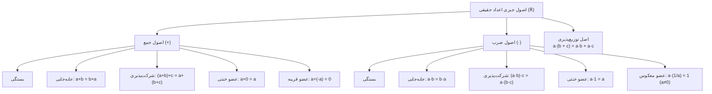

---
tags:
  - پیش‌نیاز
  - جبر_پایه
  - جبر_خطی
  - اعداد_حقیقی
  - ساختار_جبری
---
# پیش‌نیاز: اعداد حقیقی و اصول جبری

> [!TLDR] خلاصه شهودی در یک جمله
> حساب اعداد حقیقی بر پایه چند قانون ساده و تغییرناپذیر (مانند جابه‌جایی، شرکت‌پذیری و وجود عضو خنثی و قرینه) بنا شده است؛ درک این قوانین به عنوان «اصول موضوعه» کلید ورود به جبر مجرد و فهم دلیل فرمول‌بندی ۱۰ گانه فضای برداری در کتاب آکسلر است.

---

## ۱. انگیزه و ضرورت در جبر خطی
* **چرا این مفهوم را در کتاب آکسلر ندیده‌ایم اما به آن نیاز داریم؟**
  در دبیرستان، جمع و ضرب اعداد را به صورت غریزی و حفظی انجام می‌دادیم: می‌دانستیم $2 + 3 = 3 + 2$ یا $0 \times x = 0$. اما شلدون آکسلر در **تعریف ۲۰.۱ (فضای برداری)** دقیقاً همین رفتارها را برمی‌دارد و می‌گوید: «هر مجموعه‌ای از اشیاء (حتی اگر فلش، ماتریس یا تابع باشند) که این رفتارها را تقلید کنند، یک فضای برداری است!»
  علاوه بر این، در بخش‌های پایانی بخش دوم فصل ۱ (قضایای ۲۹.۱ تا ۳۱.۱)، آکسلر قضایایی مانند $0v = 0$ و $(-1)v = -v$ را **اثبات** می‌کند. دانشجوی ناآشنا تعجب می‌کند: «مگر ضرب صفر در هر چیز بدیهی نیست؟ چرا باید اثبات شود؟» پاسخ این است که در جبر دانشگاهی، هیچ چیز بدیهی نیست؛ هر گزاره‌ای باید از اصول موضوعه استنتاج شود.
* **مفاهیم متصل در کتاب:**
  - [[02-Chapter-1/02.1-Rn-and-Cn/ویژگی‌های ۳.۱ ویژگی‌های حساب مختلط|ویژگی‌های ۳.۱: ویژگی‌های حساب مختلط]]
  - [[02-Chapter-1/02.2-Vector-Spaces/تعریف ۲۰.۱ فضای برداری|تعریف ۲۰.۱: اصول موضوعه فضای برداری]]
  - [[02-Chapter-1/02.2-Vector-Spaces/قضیه ۲۶.۱ یکتایی همانی جمعی|قضیه ۲۹.۱: اثبات یکتایی عضو صفر]]
  - [[01-Prerequisites/میدان‌ها به زبان ساده (چرا نماد F)|پیش‌نیاز ۴: مفهوم میدان]]

---

## ۲. درک شهودی و تصویرسازی ذهنی

قوانین جبر مثل «قوانین بازی شطرنج» هستند. در شطرنج، فیل فقط مورب حرکت می‌کند و اسب به صورت L. این‌ها قراردادهای اولیه (Axioms / اصول موضوعه) بازی هستند. وقتی اصول را پذیرفتید، تمام تاکتیک‌ها و حرکت‌های بعدی از دل همین قوانین استخراج می‌شوند.

در اعداد حقیقی ($\mathbb{R}$) نیز دو عمل اساسی داریم: **جمع ($+$)** و **ضرب ($\cdot$)**.
این دو عمل از ۵ جفت قانون بنیادی پیروی می‌کنند:
1. **بسته بودن:** وقتی دو عدد حقیقی را جمع یا ضرب می‌کنید، حاصل از دنیای اعداد حقیقی بیرون نمی‌افتد.
2. **جابه‌جایی:** ترتیب ورود اعضا تفاوتی ایجاد نمی‌کند ($a + b = b + a$).
3. **شرکت‌پذیری:** پرانتزبندی و تقدم محاسبه تاثیری در جواب ندارد ($a + (b + c) = (a + b) + c$).
4. **عضو خنثی (همانی):** عددی که کاری به کار بقیه ندارد (صفر برای جمع، یک برای ضرب).
5. **عضو وارون:** عنصری که عملیات را به حالت خنثی بازمی‌گرداند (قرینه $-a$ برای جمع، معکوس $\frac{1}{a}$ برای ضرب).
و در نهایت، پلی که این دو بازی را به هم متصل می‌کند: **خاصیت توزیع‌پذیری (پخش)**.



---

## ۳. تعریف دقیق و فرمول‌بندی ریاضی

> [!DEFINITION] اصول موضوعه جبری اعداد حقیقی ($\mathbb{R}$)
> به ازای هر سه عدد حقیقی $a, b, c \in \mathbb{R}$، اصول زیر بدون اثبات پذیرفته می‌شوند:
> 
> ### اصول جمع ($+$)
> ۱. **بستگی:** $a + b \in \mathbb{R}$
> ۲. **جابه‌جایی (Commutativity):**
>    $$a + b = b + a$$
> ۳. **شرکت‌پذیری (Associativity):**
>    $$(a + b) + c = a + (b + c)$$
> ۴. **عضو خنثی جمعی (Additive Identity):** عددی یکتا به نام $0$ وجود دارد به طوری که:
>    $$a + 0 = a$$
> ۵. **عضو وارون جمعی / قرینه (Additive Inverse):** به ازای هر $a$، عددی به نام $-a$ وجود دارد به طوری که:
>    $$a + (-a) = 0$$
>
> ### اصول ضرب ($\cdot$)
> ۶. **بستگی:** $a \cdot b \in \mathbb{R}$
> ۷. **جابه‌جایی (Commutativity):**
>    $$a \cdot b = b \cdot a$$
> ۸. **شرکت‌پذیری (Associativity):**
>    $$(a \cdot b) \cdot c = a \cdot (b \cdot c)$$
> ۹. **عضو خنثی ضربی (Multiplicative Identity):** عددی یکتا به نام $1$ ($1 \neq 0$) وجود دارد به طوری که:
>    $$a \cdot 1 = a$$
> ۱۰. **عضو وارون ضربی / معکوس (Multiplicative Inverse):** به ازای هر $a \neq 0$، عددی به نام $a^{-1} = \frac{1}{a}$ وجود دارد به طوری که:
>     $$a \cdot a^{-1} = 1$$
>
> ### اصل پیونددهنده: توزیع‌پذیری (Distributivity)
> $$a \cdot (b + c) = a \cdot b + a \cdot c$$

```geogebra
appName: classic
width: 700
height: 380
showToolBar: false
showAlgebraInput: true
showMenuBar: false
commands:
  - "a = 2"
  - "b = 3"
  - "c = 1.5"
  - "Polygon((0, 0), (b, 0), (b, a), (0, a))"
  - "Polygon((b, 0), (b + c, 0), (b + c, a), (b, a))"
caption: "تعبیر هندسی توزیع‌پذیری مساحت مستطیل: a(b + c) = ab + ac"
explain:
  - "مستطیل اول با ابعاد 2 در 3 دارای مساحت ab = 6 است."
  - "مستطیل دوم با ابعاد 2 در 1.5 دارای مساحت ac = 3 است."
  - "مستطیل کل با ابعاد 2 در 4.5 دارای مساحت a(b + c) = 9 است که برابری جبری را به وضوح به تصویر می‌کشد."
```

---

## ۴. نمونه اثبات گام‌به‌گام بر پایه اصول (مدل کتاب آکسلر)

برای اینکه ببینید آکسلر چگونه قضایا را اثبات می‌کند، بیایید یک واقعیت بسیار ساده دبیرستانی را تنها با استفاده از این اصول اثبات کنیم:

> [!EXAMPLE] قضیه: چرا ضرب هر عدد در صفر، صفر می‌شود؟ ($a \cdot 0 = 0$)
> **هدف:** اثبات اینکه برای هر $a \in \mathbb{R}$ داریم $a \cdot 0 = 0$.
>
> **اثبات گام‌به‌گام:**
> ۱. می‌دانیم که صفر عضو خنثی جمع است، بنابراین:
>    $$0 + 0 = 0$$
> ۲. دو طرف تساوی بالا را در عدد $a$ ضرب می‌کنیم:
>    $$a \cdot (0 + 0) = a \cdot 0$$
> ۳. در سمت چپ از **خاصیت توزیع‌پذیری** استفاده می‌کنیم:
>    $$a \cdot 0 + a \cdot 0 = a \cdot 0$$
> ۴. سمت راست تساوی را با عضو خنثی جمع بازنویسی می‌کنیم ($x = x + 0$):
>    $$a \cdot 0 + a \cdot 0 = a \cdot 0 + 0$$
> ۵. اکنون به هر دو سمت، وارون جمعی عبارت $a \cdot 0$ یعنی $-(a \cdot 0)$ را اضافه می‌کنیم:
>    $$(a \cdot 0 + a \cdot 0) + (-(a \cdot 0)) = (a \cdot 0 + 0) + (-(a \cdot 0))$$
> ۶. با استفاده از شرکت‌پذیری و جابه‌جایی:
>    $$a \cdot 0 + [a \cdot 0 + (-(a \cdot 0))] = 0 + [a \cdot 0 + (-(a \cdot 0))]$$
>    $$a \cdot 0 + 0 = 0 + 0$$
>    $$a \cdot 0 = 0$$
> **نتیجه:** حکم با موفقیت و بدون هیچ فرضیه اضافی اثبات شد! در فصل اول آکسلر خواهید دید که اثبات $0v = 0$ برای بردارها دقیقاً کپی مو‌به‌موی همین مراحل است.

---

## ۵. خطاهای رایج و دام‌های مفهومی

> [!WARNING] اشتباهات متداول در اصول جبری
> - **اشتباه ۱: تصور اینکه همه ساختارهای جبری جابه‌جایی هستند:**
>   در اعداد حقیقی $a \cdot b = b \cdot a$ برقرار است. اما در ضرب ماتریس‌ها ($AB \neq BA$) یا در ترکیب توابع ($f \circ g \neq g \circ f$) جابه‌جایی به هیچ وجه برقرار نیست! به همین دلیل در جبر خطی باید نسبت به ترتیب ضرب‌ها بی‌نهایت حساس باشید.
> - **اشتباه ۲: تقسیم بر صفر:**
>   اصل دهم صراحتاً شرط می‌گذارد که $a \neq 0$. اگر صفر معکوس ضربی داشت، تناقض ریاضی $1 = 0$ حاصل می‌شد.
> - **اشتباه ۳: اشتباه گرفتن عضو خنثی با عضو جاذب:**
>   عضو خنثی عددی است که تاثیری روی عدد دیگر ندارد ($a + 0 = a$ و $a \cdot 1 = a$). اما صفر در ضرب عضو جاذب (Absorbing) است ($a \cdot 0 = 0$).

---

## ۶. پیوندها و گام بعدی
- **پیش‌نیاز قبلی:** [[01-Prerequisites/روابط و توابع - یک‌به‌یک، پوشا و دوسویی|پیش‌نیاز ۲: روابط و توابع - یک‌به‌یک، پوشا و دوسویی]]
- **پیش‌نیاز بعدی:** [[01-Prerequisites/میدان‌ها به زبان ساده (چرا نماد F)|پیش‌نیاز ۴: میدان‌ها به زبان ساده (چرا نماد F)]]
- **کاربرد در فصل‌های آکسلر:**
  - [[02-Chapter-1/02.2-Vector-Spaces/تعریف ۲۰.۱ فضای برداری|تعریف ۲۰.۱: ساختار اصل موضوعی فضای برداری]]
  - [[02-Chapter-1/02.2-Vector-Spaces/قضیه ۲۶.۱ یکتایی همانی جمعی|قضیه ۲۹.۱: اثبات ویژگی‌های پایه فضاهای برداری]]
- **بازگشت به نقشه راه:** [[00-MOCs/MOC پیش‌نیازهای ریاضی|MOC پیش‌نیازهای ریاضی]]
