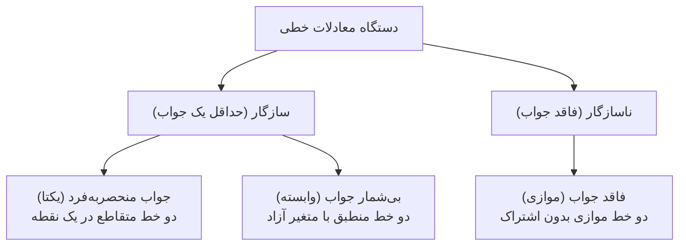

---
tags:
  - پیش‌نیاز
  - جبر_پایه
  - جبر_خطی
  - دستگاه_معادلات
  - ماتریس
  - حذف_گاوسی
---
# پیش‌نیاز: دستگاه معادلات خطی و ماتریس‌ها از نگاه دبیرستانی

> [!TLDR] خلاصه شهودی در یک جمله
> یک دستگاه معادلات خطی مجموعه‌ای از شرایط همزمان است که هندسه تقاطع خطوط و صفحات را توصیف می‌کند؛ روش حذفی گاوس ابزار مکانیکی قدرتمندی است که با استفاده از عملیات جبری سطری، مجهول‌ها را یکی پس از دیگری خلع سلاح کرده و به ما می‌گوید آیا بردارها مستقل‌اند یا به هم وابسته‌اند.

---

## ۱. انگیزه و ضرورت در جبر خطی
* **چرا این مفهوم را با وجود رویکرد بدون ماتریس آکسلر نیاز داریم؟**
  کتاب شلدون آکسلر به این معروف است که تئوری را بدون ماتریس و با تکیه بر نگاشت‌ها و فضاها پیش می‌برد. اما وقتی نوبت به **حل تمرینات فصول ۱ و ۲** می‌رسد، چه ابزاری به داد دانشجو می‌رسد؟
  وقتی تمرینی از شما می‌پرسد:
  > «آیا سه بردار $(1, 2, 0)$، $(0, 1, 1)$ و $(1, 0, -2)$ در $\mathbb{R}^3$ مستقل خطی هستند؟»
  
  معادله‌ای که باید حل کنید این است:
  $$c_1 (1, 2, 0) + c_2 (0, 1, 1) + c_3 (1, 0, -2) = (0, 0, 0)$$
  این دقیقاً یک **دستگاه همگن از ۳ معادله و ۳ مجهول** است! اگر روش حذفی گاوس و فرم پلکانی ماتریس را به خوبی ندانید، در حل مسائل عددی و محاسبات آزمون‌ها فلج خواهید شد.
* **مفاهیم متصل در کتاب:**
  - [[03-Chapter-2/03.1-Span-and-Linear-Independence/تعریف ۱۵.۲ استقلال خطی|تعریف ۶.۲: بررسی استقلال خطی از طریق حل معادله همگن]]
  - [[03-Chapter-2/03.1-Span-and-Linear-Independence/تعریف ۴.۲ گستره (Span)|تعریف ۲.۲: بررسی تعلق یک بردار به فضای گستره]]
  - فصل ۳: ماتریس نمایش یک نگاشت خطی نسبت به پایه‌ها.
  - [[01-Prerequisites/نماد سیگما و ترکیبات خطی در دبیرستان|پیش‌نیاز ۹: نماد سیگما و ترکیبات خطی]]

---

## ۲. درک شهودی و تصویرسازی ذهنی

حل یک دستگاه دو مجهولی $2 \times 2$ مانند پیدا کردن نقطه تقاطع دو خط در صفحه است:
$$\begin{cases} 2x + y = 5 \\ x - y = 1 \end{cases}$$

سه وضعیت هندسی ممکن است رخ دهد:
1. **جواب منحصر‌به‌فرد (یکتا):** دو خط در یک نقطه همدیگر را قطع می‌کنند (شیب‌ها برابر نیستند).
2. **بی‌شمار جواب:** دو خط کاملاً بر هم منطبق هستند (یک خط واحد با دو معادله مختلف). در این حالت حداقل یک **متغیر آزاد (Free Variable)** داریم.
3. **فاقد جواب (ناسازگار):** دو خط کاملاً موازی هستند و هیچ‌گاه یکدیگر را ملاقات نمی‌کنند ($0 = 4$).



```geogebra
appName: classic
width: 700
height: 380
showToolBar: false
showAlgebraInput: true
showMenuBar: false
commands:
  - "eq1: 2*x + y = 5"
  - "eq2: x - y = 1"
  - "P = Intersect(eq1, eq2)"
  - "eq3: 2*x + y = 8"
caption: "تعبیر هندسی دستگاه معادلات: تقاطع دو خط در نقطه (2, 1) و خط موازی ناسازگار"
explain:
  - "خطوط 2x + y = 5 و x - y = 1 در نقطه P = (2, 1) متقاطع‌اند (دستگاه سازگار با جواب یکتا)."
  - "خط 2x + y = 8 با خط اول موازی است و هیچ نقطه تقاطعی ندارد (دستگاه ناسازگار)."
```

در فضای ۳ بعدی، هر معادله درجه اول یک **صفحه مسطح** است و دستگاه معادلات به معنای بررسی تقاطع صفحات در فضا است (تقاطع می‌تواند یک نقطه، یک خط، یا تهی باشد).

---

## ۳. تعریف دقیق و فرمول‌بندی ریاضی

> [!DEFINITION] دستگاه معادلات خطی و فرم ماتریسی
> یک دستگاه شامل $m$ معادله و $n$ مجهول به صورت زیر تعریف می‌شود:
> $$\begin{cases}
> a_{11} x_1 + a_{12} x_2 + \dots + a_{1n} x_n = b_1 \\
> a_{21} x_1 + a_{22} x_2 + \dots + a_{2n} x_n = b_2 \\
> \vdots \\
> a_{m1} x_1 + a_{m2} x_2 + \dots + a_{mn} x_n = b_m
> \end{cases}$$
> 
> فرم ماتریسی فشرده:
> $$A x = b$$
> که در آن $A \in \mathbb{F}^{m \times n}$ ماتریس ضرایب، $x \in \mathbb{F}^n$ بردار مجهولات و $b \in \mathbb{F}^m$ بردار معلومات است.
> **ماتریس الحاقی (افزوده):** ماتریسی که بردار $b$ در کنار ضرایب قرار می‌گیرد: $[A \mid b]$.

> [!DEFINITION] عملیات سطری مقدماتی (Elementary Row Operations)
> این عملیات مجموعه جواب‌های دستگاه را تغییر نمی‌دهند:
> ۱. **جابه‌جایی دو سطر:** $R_i \leftrightarrow R_j$.
> ۲. **ضرب یک سطر در یک عدد غیرصفر:** $R_i \leftarrow c R_i \quad (c \neq 0)$.
> ۳. **افزودن مضربی از یک سطر به سطر دیگر:** $R_i \leftarrow R_i + c R_j$.

> [!DEFINITION] دستگاه همگن ($Ax = 0$) و استقلال خطی
> اگر سمت راست معادلات تماماً صفر باشد ($b = 0$)، دستگاه را **همگن (Homogeneous)** می‌نامند:
> - دستگاه همگن **همیشه** حداقل یک جواب دارد که همان جواب بدیهی $x_1 = x_2 = \dots = x_n = 0$ است.
> - **ارتباط با استقلال خطی:**
>   - اگر دستگاه $Ax = 0$ **تنها و تنها جواب بدیهی** داشته باشد $\implies$ ستون‌های ماتریس **مستقل خطی** هستند.
>   - اگر دستگاه علاوه بر صفر، **جواب‌های غیربدیهی (غیرصفر)** داشته باشد $\implies$ ستون‌های ماتریس **وابسته خطی** هستند.
> - **قضیه کلیدی:** اگر تعداد مجهولات بیشتر از تعداد معادلات باشد ($n > m$)، دستگاه همگن قطعاً متغیر آزاد دارد و جواب‌های غیرصفر بی‌شمار خواهد داشت (این قضیه ستون فقرات اثبات قضیه ۲.۲۳ آکسلر است).

---

## ۴. مثال عددی گام‌به‌گام: روش حذفی گاوس

> [!EXAMPLE] بررسی استقلال خطی با روش حذفی گاوس
> **مسئله:** آیا سه بردار زیر در $\mathbb{R}^3$ مستقل خطی هستند؟
> $$v_1 = (1, 1, 2), \quad v_2 = (1, 0, 1), \quad v_3 = (2, 1, 3)$$
> 
> **حل گام‌به‌گام:**
> ۱. معادله برداری استقلال خطی را می‌نویسیم:
>    $$c_1 v_1 + c_2 v_2 + c_3 v_3 = (0, 0, 0)$$
> ۲. ماتریس ضرایب دستگاه را تشکیل می‌دهیم (بردارها به صورت ستونی):
>    $$A = \begin{bmatrix} 1 & 1 & 2 \\ 1 & 0 & 1 \\ 2 & 1 & 3 \end{bmatrix}$$
> 
> ۳. اعمال سطری مقدماتی برای رسیدن به فرم پلکانی:
>    - سطر اول را از سطر دوم کم می‌کنیم ($R_2 \leftarrow R_2 - R_1$):
>      $$\begin{bmatrix} 1 & 1 & 2 \\ 0 & -1 & -1 \\ 2 & 1 & 3 \end{bmatrix}$$
>    - دو برابر سطر اول را از سطر سوم کم می‌کنیم ($R_3 \leftarrow R_3 - 2R_1$):
>      $$\begin{bmatrix} 1 & 1 & 2 \\ 0 & -1 & -1 \\ 0 & -1 & -1 \end{bmatrix}$$
>    - سطر دوم را از سطر سوم کم می‌کنیم ($R_3 \leftarrow R_3 - R_2$):
>      $$\begin{bmatrix} 1 & 1 & 2 \\ 0 & -1 & -1 \\ 0 & 0 & 0 \end{bmatrix}$$
> 
> ۴. تحلیل سطر صفر:
>    سطر سوم تماماً صفر شد ($0 \cdot c_3 = 0$)! این یعنی مجهول $c_3$ یک **متغیر آزاد** است.
>    اگر قرار دهیم $c_3 = 1$:
>    - از سطر دوم: $-c_2 - c_3 = 0 \implies c_2 = -c_3 = -1$.
>    - از سطر اول: $c_1 + c_2 + 2c_3 = 0 \implies c_1 - 1 + 2(1) = 0 \implies c_1 = -1$.
> 
> ۵. **نتیجه‌گیری:**
>    ضرایب غیرصفر پیدا شدند:
>    $$-1 v_1 - 1 v_2 + 1 v_3 = 0 \implies v_3 = v_1 + v_2$$
>    بنابراین بردارها **وابسته خطی** هستند و $v_3$ در صفحه دو بردار اول قرار دارد!

---

## ۵. خطاهای رایج و دام‌های مفهومی

> [!WARNING] اشتباهات متداول در دستگاه معادلات و ماتریس‌ها
> - **اشتباه ۱: تصور اینکه دستگاه همگن می‌تواند فاقد جواب باشد:**
>   یک دستگاه همگن ($Ax = 0$) **هرگز بی‌جواب نیست!** زیرا بردار صفر ($x=0$) همواره در آن صدق می‌کند. بنابراین یا دقیقاً ۱ جواب دارد (فقط صفر) یا بی‌شمار جواب دارد.
> - **اشتباه ۲: اشتباه گرفتن سطر صفر ($0=0$) با تناقض ($0=5$):**
>   سطر تماماً صفر $\begin{bmatrix} 0 & 0 & \dots & 0 \mid 0 \end{bmatrix}$ به معنای وجود بی‌شمار جواب و متغیر آزاد است؛ اما سطر $\begin{bmatrix} 0 & 0 & \dots & 0 \mid 5 \end{bmatrix}$ به معنای تناقض $0 = 5$ و عدم وجود هیچ جوابی است.
> - **اشتباه ۳: اشتباهات محاسباتی علامت منفی در سطرهای ماتریس:**
>   بیش از ۸۰٪ خطاهای دانشجویان در حذف گاوسی ناشی از فراموش کردن علامت منفی در حین ضرب و تفریق سطرهاست ($R_i - c R_j$). همیشه محاسبات را گام‌به‌گام روی کاغذ یادداشت کنید.

---

## ۶. پیوندها و گام بعدی
- **پیش‌نیاز قبلی:** [[01-Prerequisites/استقرای ریاضی و کاربرد آن در جبر خطی|پیش‌نیاز ۱۰: استقرای ریاضی و کاربرد آن در جبر خطی]]
- **کاربرد در فصل‌های آکسلر:**
  - [[03-Chapter-2/03.1-Span-and-Linear-Independence/تعریف ۱۵.۲ استقلال خطی|تعریف ۶.۲: استقلال خطی و حل عددی دستگاه]]
  - [[03-Chapter-2/03.1-Span-and-Linear-Independence/قضیه ۲۲.۲ طول لیست مستقل خطی کمتر مساوی طول لیست مولد است|قضیه ۲۳.۲: قضیه محوری مقایسه طول لیست مستقل و مولد]]
  - تمام تمرینات عددی فصل‌های ۱ و ۲ در [[00-MOCs/MOC حل تمرینات جبر خطی|MOC حل تمرینات جبر خطی]].
- **بازگشت به نقشه راه:** [[00-MOCs/MOC پیش‌نیازهای ریاضی|MOC پیش‌نیازهای ریاضی]]
- **ورود به فصل اول کتاب:** [[00-MOCs/MOC فصل ۱ - فضاهای برداری|MOC فصل ۱ - فضاهای برداری]]
