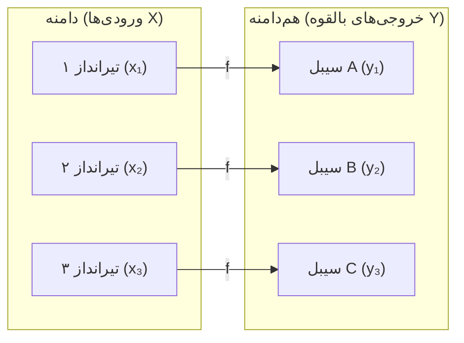

---
tags:
  - پیش‌نیاز
  - جبر_پایه
  - جبر_خطی
  - توابع
  - نگاشت_خطی
---
# پیش‌نیاز: روابط و توابع - یک‌به‌یک، پوشا و دوسویی

> [!TLDR] خلاصه شهودی در یک جمله
> تابع همانند یک دستگاه یا کارخانه با ورودی و خروجی معین است که به هر ورودی دقیقاً یک خروجی نسبت می‌دهد؛ «یک‌به‌یک بودن» یعنی هیچ دو ورودی متفاوتی یک خروجی یکسان تولید نکنند، «پوشا بودن» یعنی همه خروجی‌های ممکن واقعاً تولید شوند، و «دوسویی» یعنی یک ارتباط دوطرفه کامل و بدون نقص که قابلیت برگشت‌پذیری (معکوس) دارد.

---

## ۱. انگیزه و ضرورت در جبر خطی
* **چرا این مفهوم را در کتاب آکسلر ندیده‌ایم اما به آن نیاز داریم؟**
  قلب تپنده جبر خطی مدرن «نگاشت‌های خطی» (Linear Maps) یا تبدیلات خطی هستند. آکسلر در فصل اول فضای توابع $\mathbb{F}^S$ را معرفی می‌کند و در فصل سوم تمام تمرکز خود را بر نگاشت‌های $T: V \to W$ می‌گذارد. 
  مفاهیمی مانند:
  - **پوچ‌ساز (Kernel / Null Space):** بردار‌هایی که به صفر نگاشت می‌شوند و ارتباط مستقیم با یک‌به‌یک بودن دارند.
  - **برد (Range):** خروجی‌های حاصل از تبدیل و ارتباط آن با پوشا بودن.
  - **یکریختی (Isomorphism):** دو فضای برداری که از نظر ساختاری دوقلوی همسان هستند و با یک نگاشت «دوسو» (یک‌به‌یک و پوشا) به هم متصل‌اند.
  اگر تعریف دقیق یک‌به‌یک و پوشا را ندانید، فهم قضیه اساسی نگاشت‌های خطی (رتبه-پوچی) غیرممکن خواهد شد.
* **مفاهیم متصل در کتاب:**
  - [[02-Chapter-1/02.2-Vector-Spaces/نماد ۲۴.۱ فضای توابع FS|تعریف ۲۳.۱: فضای توابع F^S]]
  - فصل ۳: تعریف نگاشت‌های خطی، نگاشت‌های یک‌به‌یک و پوشا، و نگاشت معکوس‌پذیر ($T^{-1}$).

---

## ۲. درک شهودی و تصویرسازی ذهنی

برای درک سه خاصیت اساسی توابع، یک آزمون تیراندازی با کمان را مجسم کنید که در آن تیراندازها (دامنه) به سمت سیبل‌ها (هم‌دامنه) تیر پرتاب می‌کنند:



1. **قانون تابع بودن:** هر تیرانداز باید شلیک کند و فقط یک تیر پرتاب کند (هیچ ورودی بدون خروجی یا با دو خروجی متفاوت نمی‌ماند).
2. **یک‌به‌یک (Injective):** هیچ دو تیراندازی به یک سیبل مشترک نمی‌زنند. (هر هدف حداکثر یک تیر دریافت می‌کند). اگر دو تیر به یک سیبل خورده باشد، قطعاً هر دو متعلق به یک نفر بوده است!
3. **پوشا (Surjective):** تمام سیبل‌های موجود در سالن حداقل یک تیر خورده‌اند (هیچ سیبل دست‌نخورده‌ای در هم‌دامنه باقی نمانده است).
4. **دوسویی یا معکوس‌پذیر (Bijective):** هم یک‌به‌یک است و هم پوشا. تعداد تیراندازها و سیبل‌ها برابر است و به هر سیبل دقیقاً یک تیر اصابت کرده است. در این حالت، می‌توان بازی را برعکس کرد: از روی تیرها دقیقاً تیرانداز را شناسایی کرد! این همان **تابع وارون ($f^{-1}$)** است.

---

## ۳. تعریف دقیق و فرمول‌بندی ریاضی

> [!DEFINITION] تابع، دامنه و هم‌دامنه
> یک تابع $f$ از مجموعه $X$ به مجموعه $Y$ (با نماد $f: X \to Y$) رابطه‌ای است که به هر عضو $x \in X$ دقیقاً یک عضو $y \in Y$ را نسبت می‌دهد که آن را با $f(x)$ نشان می‌دهیم.
> - **دامنه (Domain):** مجموعه $X$ (تمام ورودی‌های مجاز).
> - **هم‌دامنه (Codomain):** مجموعه $Y$ (تمام خروجی‌های بالقوه).
> - **برد یا تصویر (Image / Range):** مجموعه خروجی‌های واقعی:
>   $$\operatorname{range}(f) = \{f(x) \mid x \in X\} \subseteq Y$$

> [!DEFINITION] نگاشت یک‌به‌یک (Injective / One-to-One)
> تابع $f: X \to Y$ را **یک‌به‌یک** می‌نامند هرگاه ورودی‌های متمایز به خروجی‌های متمایز نگاشته شوند. فرمول‌بندی معادل منطقی (عکس نقیض):
> $$f(x_1) = f(x_2) \implies x_1 = x_2$$
> *کاربرد در جبر خطی:* یک تبدیل خطی $T$ یک‌به‌یک است اگر و تنها اگر تنها برداری که به صفر تبدیل می‌شود، خود بردار صفر باشد ($\operatorname{null}(T) = \{0\}$).

> [!DEFINITION] نگاشت پوشا (Surjective / Onto)
> تابع $f: X \to Y$ را **پوشا** می‌نامند هرگاه برد تابع با کل هم‌دامنه برابر باشد. یعنی به ازای هر $y \in Y$، حداقل یک $x \in X$ وجود داشته باشد به طوری که:
> $$\forall y \in Y, \quad \exists x \in X \quad \text{such that} \quad f(x) = y$$
> *کاربرد در جبر خطی:* یک تبدیل خطی $T: V \to W$ پوشاست اگر و تنها اگر $\operatorname{range}(T) = W$.

> [!DEFINITION] نگاشت دوسویی و وارون‌پذیری (Bijective / Invertible)
> تابعی که هم **یک‌به‌یک** و هم **پوشا** باشد را **دوسو** می‌نامند. در این صورت تابعی وارون $f^{-1}: Y \to X$ وجود دارد به طوری که:
> $$f^{-1}(f(x)) = x \quad \text{و} \quad f(f^{-1}(y)) = y$$

---

## ۴. مثال‌های عددی گام‌به‌گام

> [!EXAMPLE] مثال ۱: بررسی یک‌به‌یک و پوشا بودن یک تابع خطی ساده
> **مسئله:** تابع $f: \mathbb{R} \to \mathbb{R}$ با ضابطه $f(x) = 3x - 5$ را از نظر یک‌به‌یک و پوشا بودن بررسی کنید و وارون آن را بیابید.
>
> **حل گام‌به‌گام:**
> ۱. **بررسی یک‌به‌یک بودن:**
>    فرض می‌کنیم $f(x_1) = f(x_2)$. باید نتیجه بگیریم $x_1 = x_2$:
>    $$3x_1 - 5 = 3x_2 - 5$$
>    به دو طرف عدد ۵ را اضافه می‌کنیم:
>    $$3x_1 = 3x_2$$
>    دو طرف را بر ۳ تقسیم می‌کنیم:
>    $$x_1 = x_2$$
>    پس تابع **یک‌به‌یک** است.
>
> ۲. **بررسی پوشا بودن:**
>    فرض می‌کنیم $y \in \mathbb{R}$ دلخواه در هم‌دامنه باشد. آیا $x$ وجود دارد که $f(x) = y$؟
>    $$y = 3x - 5 \implies y + 5 = 3x \implies x = \frac{y + 5}{3}$$
>    چون به ازای هر عدد حقیقی $y$، مقدار $x = \frac{y+5}{3}$ نیز عددی حقیقی و معتبر است، پس همواره ورودی متناظری وجود دارد. پس تابع **پوشا** است.
>
> ۳. **یافتن ضابطه وارون:**
>    چون تابع دوسو است، تابع وارون وجود دارد:
>    $$f^{-1}(y) = \frac{y + 5}{3} \quad \text{یا به متغیر معمول:} \quad f^{-1}(x) = \frac{x + 5}{3}$$

> [!EXAMPLE] مثال ۲: اهمیت دامنه و هم‌دامنه (مثال نقض)
> تابع $g: \mathbb{R} \to \mathbb{R}$ با ضابطه $g(x) = x^2$:
> - **یک‌به‌یک نیست:** زیرا $g(2) = 4$ و $g(-2) = 4$، در حالی که $2 \neq -2$. دو ورودی متمایز به خروجی یکسان رسیده‌اند.
> - **پوشا نیست:** عدد $-4$ در هم‌دامنه $\mathbb{R}$ قرار دارد، اما هیچ عدد حقیقی $x$ وجود ندارد که $x^2 = -4$. بنابراین $\operatorname{range}(g) = [0, +\infty) \neq \mathbb{R}$.

```geogebra
appName: 3d
width: 700
height: 450
showToolBar: false
showAlgebraInput: true
showMenuBar: false
commands:
  - "f(x) = 3*x - 5"
  - "g(x) = x^2"
  - "y0 = 4"
  - "line1 = Line((-10, y0), (10, y0))"
  - "Intersect(g, Line((-10, y0), (10, y0)))"
caption: "آزمون خط افقی: تابع یک‌به‌یک f(x) = 3x - 5 در برابر تابع غیر یک‌به‌یک g(x) = x^2"
explain:
  - "خط افقی y = 4 سهمی g(x) = x^2 را در دو نقطه متقارن قطع می‌کند، پس g یک‌به‌یک نیست."
  - "تابع خطی f(x) = 3x - 5 هر خط افقی را در حداکثر یک نقطه قطع می‌کند و تمام R را پوشش می‌دهد (یک‌به‌یک و پوشا)."
```

---

## ۵. خطاهای رایج و دام‌های مفهومی

> [!WARNING] اشتباهات متداول در درک توابع
> - **اشتباه ۱: خلط هم‌دامنه با برد:**
>   هم‌دامنه مجموعه هدفی است که در تعریف تابع ادعا می‌شود ($Y$)، اما برد زیرمجموعه‌ای است که واقعاً توسط خروجی‌ها پوشش داده می‌شود. تنها زمانی که برد با هم‌دامنه مساوی شود، تابع پوشاست.
> - **اشتباه ۲: نادیده گرفتن دامنه در بررسی یک‌به‌یک بودن:**
>   تابع $f(x) = x^2$ روی کل $\mathbb{R}$ یک‌به‌یک نیست؛ اما اگر دامنه را به اعداد نامنفی محدود کنیم ($f: [0, +\infty) \to [0, +\infty)$)، این تابع هم یک‌به‌یک و هم پوشا می‌شود! در جبر خطی، دامنه و هم‌دامنه بخشی جدایی‌ناپذیر از هویت نگاشت هستند.
> - **اشتباه ۳: اشتباه گرفتن وارون تابع با وارون ضربی:**
>   $f^{-1}(x)$ هرگز به معنای $\frac{1}{f(x)}$ نیست! $f^{-1}$ تابع معکوس‌کننده فرآیند است، در حالی که $\frac{1}{f(x)}$ مقدار عددی معکوس خروجی است.

---

## ۶. پیوندها و گام بعدی
- **پیش‌نیاز قبلی:** [[01-Prerequisites/مجموعه‌ها و نمادهای پایه ریاضی|پیش‌نیاز ۱: مجموعه‌ها و نمادهای پایه ریاضی]]
- **پیش‌نیاز بعدی:** [[01-Prerequisites/اعداد حقیقی و اصول جبری|پیش‌نیاز ۳: اعداد حقیقی و اصول جبری]]
- **کاربرد در فصل‌های آکسلر:**
  - [[02-Chapter-1/02.2-Vector-Spaces/نماد ۲۴.۱ فضای توابع FS|تعریف ۲۳.۱: فضای توابع F^S]]
  - فصل ۳: قضیه اساسی تبدیل‌های خطی (Rank-Nullity Theorem) و بررسی ایزومورفیسم.
- **بازگشت به نقشه راه:** [[00-MOCs/MOC پیش‌نیازهای ریاضی|MOC پیش‌نیازهای ریاضی]]
