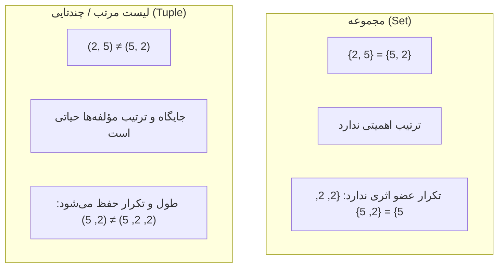

---
tags:
  - پیش‌نیاز
  - جبر_پایه
  - جبر_خطی
  - زوج_مرتب
  - لیست
---
# پیش‌نیاز: زوج‌های مرتب و n-تایی‌های مرتب

> [!TLDR] خلاصه شهودی در یک جمله
> یک $n$-تایی مرتب (یا «لیست» به زبان شلدون آکسلر) دنباله‌ای منظم از اشیاء است که در آن «ترتیب قرارگیری» و «تکرار عناصر» اهمیت حیاتی دارند؛ بر خلاف مجموعه‌ها، جابه‌جا کردن یا حذف عناصر تکراری یک لیست، هویت آن را کاملاً تغییر می‌دهد.

---

## ۱. انگیزه و ضرورت در جبر خطی
* **چرا این مفهوم را در کتاب آکسلر می‌بینیم؟**
  کتاب شلدون آکسلر در همان صفحات اولیه فصل ۱ (تعاریف ۸.۱ تا ۱۱.۱)، مفهوم **«لیست» (List)** را سنگ‌بنای تعریف فضای اصلی جبر خطی یعنی $\mathbb{F}^n$ قرار می‌دهد. آکسلر حتی یک مثال اختصاصی (**مثال ۹.۱**) می‌زند تا فرق میان لیست و مجموعه را گوشزد کند:
  > اگر فرق میان $(1, 2)$ و $\{1, 2\}$ را ندانید، نمی‌توانید بفهمید که چرا بردار $(1, 2)$ در صفحه مختصات یک نقطه است و بردار $(2, 1)$ نقطه‌ای کاملاً متفاوت!
  
  همچنین در فصل دوم، مفهوم «پایه» (Basis) به صورت یک **«لیست مرتب از بردارها»** تعریف می‌شود، نه یک مجموعه از بردارها؛ زیرا وقتی از مختصات یک بردار نسبت به یک پایه صحبت می‌کنیم، باید مشخص باشد کدام بردار اول، کدام دوم و کدام $n$-اُم است.
* **مفاهیم متصل در کتاب:**
  - [[02-Chapter-1/02.1-Rn-and-Cn/تعریف ۸.۱ لیست و طول لیست|تعریف ۸.۱: تعریف لیست و طول آن در آکسلر]]
  - [[02-Chapter-1/02.1-Rn-and-Cn/مثال ۹.۱ لیست‌ها در برابر مجموعه‌ها|مثال ۹.۱: مقایسه دقیق لیست در برابر مجموعه]]
  - [[02-Chapter-1/02.1-Rn-and-Cn/تعریف ۱۱.۱ فضای Fn و مختصات|تعریف ۱۱.۱: تعریف رسمی فضای Fn]]
  - [[01-Prerequisites/مجموعه‌ها و نمادهای پایه ریاضی|پیش‌نیاز ۱: مجموعه‌ها و ضرب دکارتی]]

---

## ۲. درک شهودی و تصویرسازی ذهنی

یک گاوصندوق رمزدار با ۳ چرخ‌دنده را تصور کنید:
- اگر رمز گاوصندوق **$(3, 7, 1)$** باشد:
  1. آیا می‌توانید آن را به صورت $(7, 3, 1)$ وارد کنید و در باز شود؟ **خیر!** ترتیب مهم است.
  2. اگر رمز **$(5, 5, 2)$** باشد، آیا می‌توانید بگویید «چون ۵ تکراری است پس رمز همان $(5, 2)$ است»؟ **خیر!** تکرار مهم است و طول رمز باید حفظ شود.

حالا این را با یک سبد خرید مقایسه کنید:
- سبد خرید $\{ \text{سیب}, \text{پرتقال} \}$ با سبد $\{ \text{پرتقال}, \text{سیب} \}$ یکی است (این یک **مجموعه** است).
- اما آدرس خانه شما در یک شهر: (خیابان ۵، کوچه ۲، پلاک ۱۰) یک **سه‌تایی مرتب** است. جابه‌جا کردن اعداد شما را به خانه شخص دیگری می‌برد!



```geogebra
appName: classic
width: 700
height: 380
showToolBar: false
showAlgebraInput: true
showMenuBar: false
commands:
  - "A = (2, 5)"
  - "B = (5, 2)"
  - "O = (0, 0)"
  - "u = Vector(O, A)"
  - "v = Vector(O, B)"
  - "Pt1 = (6, 6)"
  - "line2 = Line(O, Pt1)"
caption: "تمایز زوج‌های مرتب (2, 5) و (5, 2) در صفحه مختصات"
explain:
  - "نقطه A = (2, 5) دارای طول ۲ و عرض ۵ است."
  - "نقطه B = (5, 2) دارای طول ۵ و عرض ۲ است."
  - "این دو نقطه قرینه یکدیگر نسبت به خط نیمساز y = x هستند و نشان می‌دهند جابه‌جایی مؤلفه‌ها هویت نقطه را تغییر می‌دهد."
```

---

## ۳. تعریف دقیق و فرمول‌بندی ریاضی

> [!DEFINITION] چندتایی مرتب (Tuple / List)
> فرض کنید $n$ یک عدد صحیح نامنفی باشد. یک **$n$-تایی مرتب** (یا لیستی به طول $n$) از اعضای یک مجموعه $S$، دنباله‌ای به شکل زیر است:
> $$(x_1, x_2, \dots, x_n)$$
> که در آن هر $x_j \in S$ را **مؤلفه $j$-اُم (Coordinate / Entry)** می‌نامند.
> 
> - اگر $n=2$ باشد: **زوج مرتب** (Ordered pair) مانند $(x, y)$.
> - اگر $n=3$ باشد: **سه‌تایی مرتب** (Ordered triple) مانند $(x, y, z)$.
> - اگر $n=0$ باشد: لیست خالی با طول صفر $()$.

> [!DEFINITION] تساوی دو چندتایی مرتب
> دو $n$-تایی مرتب $(x_1, \dots, x_n)$ و $(y_1, \dots, y_m)$ با هم برابرند اگر و تنها اگر:
> ۱. طول آن‌ها برابر باشد ($n = m$).
> ۲. نظیر به نظیر در تمامی مؤلفه‌ها یکسان باشند:
>    $$(x_1, \dots, x_n) = (y_1, \dots, y_n) \iff \forall j \in \{1, \dots, n\}: x_j = y_j$$

> [!DEFINITION] فضای $\mathbb{F}^n$
> مجموعه تمام $n$-تایی‌های مرتب که مؤلفه‌های آن‌ها از میدان $\mathbb{F}$ ($\mathbb{R}$ یا $\mathbb{C}$) باشند، با $\mathbb{F}^n$ نشان داده می‌شود:
> $$\mathbb{F}^n = \{(x_1, x_2, \dots, x_n) \mid x_1, x_2, \dots, x_n \in \mathbb{F}\}$$
> 
> عملیات اساسی در $\mathbb{F}^n$ به صورت **مؤلفه به مؤلفه (Component-wise)** تعریف می‌شوند:
> ۱. **جمع برداری:**
>    $$(x_1, \dots, x_n) + (y_1, \dots, y_n) = (x_1 + y_1, \dots, x_n + y_n)$$
> ۲. **ضرب اسکالر:**
>    $$c(x_1, \dots, x_n) = (cx_1, \dots, cx_n) \quad (c \in \mathbb{F})$$

---

## ۴. مثال‌های عددی گام‌به‌گام

> [!EXAMPLE] مثال ۱: تفاوت‌های بنیادی لیست و مجموعه
> ۱. تساوی مجموعه‌ها:
>    $$\{2, 5\} = \{5, 2\} = \{2, 2, 5\}$$
> ۲. عدم تساوی لیست‌ها:
>    $$(2, 5) \neq (5, 2)$$
>    چون مؤلفه اول سمت چپ ۲ است ولی مؤلفه اول سمت راست ۵ است ($2 \neq 5$).
> ۳. تفاوت طول لیست‌ها:
>    $$(2, 2, 5) \neq (2, 5)$$
>    طول اولی ۳ است و طول دومی ۲.

> [!EXAMPLE] مثال ۲: عملیات در فضای مختصاتی $\mathbb{R}^3$
> فرض کنید دو بردار $u = (1, -2, 4)$ و $v = (3, 0, -1)$ در $\mathbb{R}^3$ داده شده باشند.
> مطلوب است محاسبه $2u - 3v$:
> 
> **حل گام‌به‌گام:**
> ۱. محاسبه $2u$:
>    $$2u = 2(1, -2, 4) = (2(1), 2(-2), 2(4)) = (2, -4, 8)$$
> ۲. محاسبه $3v$:
>    $$3v = 3(3, 0, -1) = (3(3), 3(0), 3(-1)) = (9, 0, -3)$$
> ۳. تفریق مؤلفه‌به‌مؤلفه:
>    $$2u - 3v = (2 - 9, -4 - 0, 8 - (-3)) = (-7, -4, 8 + 3) = (-7, -4, 11)$$
> نتیجه یک ۳-تایی مرتب در $\mathbb{R}^3$ است.

---

## ۵. خطاهای رایج و دام‌های مفهومی

> [!WARNING] اشتباهات متداول
> - **اشتباه ۱: استفاده از آکولاد به جای پرانتز:**
>   نوشتن بردار به شکل $\{x_1, x_2, \dots, x_n\}$ اشتباه است! در جبر خطی، بردارها در $\mathbb{F}^n$ حتماً درون پرانتز یا کروشه نوشته می‌شوند تا تقدم و تاخر مؤلفه‌ها حفظ شود.
> - **اشتباه ۲: جمع بردار با طول‌های مختلف:**
>   نمی‌توان بردار $(1, 2) \in \mathbb{R}^2$ را با بردار $(1, 2, 3) \in \mathbb{R}^3$ جمع کرد. عمل جمع فقط بین اعضای یک فضای هم‌طول تعریف شده است.
> - **اشتباه ۳: اشتباه گرفتن بعد فضا با مقدار عددی اعضا:**
>   بردار $(0, 0, 0, 0)$ دارای مقدار صفر است، اما طول آن ۴ است؛ یعنی عضوی از فضای چهاربعدی $\mathbb{F}^4$ است، نه فضای صفر!

---

## ۶. پیوندها و گام بعدی
- **پیش‌نیاز قبلی:** [[01-Prerequisites/اعداد مختلط از صفر تا صد|پیش‌نیاز ۵: اعداد مختلط از صفر تا صد]]
- **پیش‌نیاز بعدی:** [[01-Prerequisites/تعبیر هندسی بردارها در صفحه و فضا|پیش‌نیاز ۷: تعبیر هندسی بردارها در صفحه و فضا]]
- **کاربرد در فصل‌های آکسلر:**
  - [[02-Chapter-1/02.1-Rn-and-Cn/تعریف ۸.۱ لیست و طول لیست|تعریف ۸.۱: تعریف لیست در آکسلر]]
  - [[02-Chapter-1/02.1-Rn-and-Cn/تعریف ۱۱.۱ فضای Fn و مختصات|تعریف ۱۱.۱: تعریف فضای Fn]]
  - [[02-Chapter-1/02.1-Rn-and-Cn/تعریف ۱۳.۱ جمع در Fn|تعریف ۱۳.۱: جمع و ضرب اسکالر در Fn]]
- **بازگشت به نقشه راه:** [[00-MOCs/MOC پیش‌نیازهای ریاضی|MOC پیش‌نیازهای ریاضی]]
