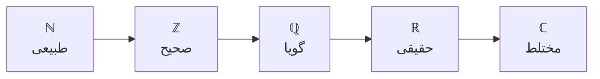

---
tags:
  - پیش‌نیاز
  - جبر_پایه
  - جبر_خطی
  - نظریه_مجموعه‌ها
aliases:
  - مجموعه‌ها و نمادهای پایه ریاضی
---
# پیش‌نیاز: مجموعه‌ها و نمادهای پایه ریاضی

> [!TLDR] خلاصه شهودی در یک جمله
> مجموعه همانند یک جعبه یا سبد است که اشیاء معینی (مانند اعداد یا بردارها) را بدون در نظر گرفتن ترتیب و بدون تکرار عضو درون خود نگه می‌دارد؛ نمادهای عضویت، زیرمجموعه و ضرب دکارتی الفبای خواندن و نوشتن تمام قضایای جبر خطی هستند.

---

## ۱. انگیزه و ضرورت در جبر خطی
* **چرا این مفهوم را در کتاب آکسلر ندیده‌ایم اما به آن نیاز داریم؟**
  کتاب *Linear Algebra Done Right* از همان خط اول فرض می‌کند که شما زبان مجموعه‌ها را روان صحبت می‌کنید. وقتی آکسلر می‌نویسد:
  $$V \text{ is a vector space over } \mathbb{F}$$
  یا وقتی زیرفضای برداری را به عنوان «زیرمجموعه‌ای از $V$ که دارای سه شرط خاص است» تعریف می‌کند، از نمادهای نظریه مجموعه‌ها مانند عضویت ($\in$)، زیرمجموعه بودن ($\subseteq$ یا $\subset$)، اشتراک ($\cap$) و اجتماع ($\cup$) استفاده می‌کند. بدون درک دقیق تمایز میان «عضو یک مجموعه بودن» و «زیرمجموعه یک مجموعه بودن»، درک تفاوت میان **بردار** و **زیرفضا** غیرممکن خواهد بود.
* **مفاهیم متصل در کتاب:**
  - [[02-فصل اول - فضاهای برداری/01-فضاهای عددی (Rn و Cn)/تعریف ۱۱.۱ فضای Fn و مختصات|تعریف ۱۱.۱: فضای Fn به عنوان ضرب دکارتی n-تایی]]
  - [[02-فصل اول - فضاهای برداری/02-اصول موضوعه و تعریف فضای برداری/تعریف ۲۰.۱ فضای برداری|تعریف ۲۰.۱: فضای برداری به عنوان یک مجموعه با دو عمل]]
  - [[02-فصل اول - فضاهای برداری/03-زیرفضاها و جمع مستقیم/تعریف ۳۱.۱ زیرفضا (Subspace)|تعریف ۲۷.۱: زیرفضای برداری به عنوان زیرمجموعه بسته]]
  - [[01-پیش‌نیازها و یادآوری دبیرستان/06-زوج‌های مرتب و n-تایی‌های مرتب|پیش‌نیاز ۶: زوج‌های مرتب و ضرب دکارتی]]

---

## ۲. درک شهودی و تصویرسازی ذهنی

تصور کنید یک کمد ابزار دارید:
1. **مجموعه (Set):** خود کمد یا یک طبقه از کمد است. به عنوان مثال، اگر طبقه اول شامل «آچار، پیچ‌گوشتی، انبردست» باشد، این یک مجموعه ۳ عضوی است.
2. **عضویت ($\in$):** آیا آچار در این طبقه است؟ بله، می‌نویسیم $\text{آچار} \in \text{طبقه اول}$. اما خود آچار یک طبقه نیست، بلکه یک «عضو» درون آن است.
3. **زیرمجموعه ($\subseteq$):** اگر جعبه کوچکی درون این طبقه باشد که فقط شامل آچار و انبردست است، تمام ابزارهای این جعبه در طبقه اول هم هستند؛ پس جعبه کوچک «زیرمجموعه» طبقه اول است: $\text{جعبه کوچک} \subseteq \text{طبقه اول}$.
4. **بی‌اثری ترتیب و تکرار:** اگر بگویید «در این طبقه انبردست، آچار و انبردست هست»، دقیقاً همان را گفته‌اید که بگویید «در این طبقه آچار و انبردست هست». در ریاضی:
   $$\{1, 2, 2, 3\} = \{1, 2, 3\} = \{3, 2, 1\}$$

---

## ۳. تعریف دقیق و فرمول‌بندی ریاضی

> [!DEFINITION] نمادهای استاندارد مجموعه‌های عددی
> در سرتاسر ریاضیات دانشگاهی و کتاب آکسلر، مجموعه‌های زیر با حروف توخالی (Blackboard Bold) مشخص می‌شوند:
> * $\mathbb{N} = \{1, 2, 3, \dots\}$: مجموعه اعداد طبیعی (Natural numbers).
> * $\mathbb{Z} = \{\dots, -2, -1, 0, 1, 2, \dots\}$: مجموعه اعداد صحیح (Integers).
> * $\mathbb{Q} = \left\{\frac{a}{b} \mid a, b \in \mathbb{Z}, b \neq 0\right\}$: مجموعه اعداد گویا (Rational numbers).
> * $\mathbb{R}$: مجموعه اعداد حقیقی (Real numbers).
> * $\mathbb{C} = \{a + bi \mid a, b \in \mathbb{R}, i^2 = -1\}$: مجموعه اعداد مختلط (Complex numbers).
> * رابطه شمول میان آن‌ها:
>   $$\mathbb{N} \subset \mathbb{Z} \subset \mathbb{Q} \subset \mathbb{R} \subset \mathbb{C}$$



> [!DEFINITION] عملگرها و روابط بنیادین مجموعه‌ها
> ۱. **عضویت ($x \in A$):** گزاره‌ای که بیان می‌کند شیء $x$ متعلق به مجموعه $A$ است. نقیض آن: $x \notin A$.
> ۲. **مجموعه تهی ($\emptyset$ یا $\{\}$):** مجموعه‌ای فاقد هرگونه عضو. مجموعه تهی زیرمجموعه هر مجموعه‌ای است ($\emptyset \subseteq A$).
> ۳. **زیرمجموعه ($A \subseteq B$):** به ازای هر $x$، اگر $x \in A$ آنگاه $x \in B$:
>    $$A \subseteq B \iff (\forall x: x \in A \implies x \in B)$$
> ۴. **زیرمجموعه سره ($A \subset B$ یا $A \subsetneq B$):** $A \subseteq B$ و در عین حال $A \neq B$.
> ۵. **اجتماع ($A \cup B$):** اعضایی که در حداقل یکی از دو مجموعه حضور دارند:
>    $$A \cup B = \{x \mid x \in A \text{ یا } x \in B\}$$
> ۶. **اشتراک ($A \cap B$):** اعضایی که در هر دو مجموعه حضور دارند:
>    $$A \cap B = \{x \mid x \in A \text{ و } x \in B\}$$
> ۷. **تفاضل ($A \setminus B$ یا $A - B$):** اعضایی از $A$ که در $B$ نیستند:
>    $$A \setminus B = \{x \mid x \in A \text{ و } x \notin B\}$$
> ۸. **ضرب دکارتی ($A \times B$):** مجموعه تمام زوج‌های مرتب $(a, b)$ به طوری که $a \in A$ و $b \in B$:
>    $$A \times B = \{(a, b) \mid a \in A, b \in B\}$$
>    اگر $n$ بار تکرار شود، فضا به صورت $A^n = \underbrace{A \times A \times \dots \times A}_{n \text{ بار}}$ تعریف می‌شود.

> [!NOTE] نماد ریاضی‌سازی شرطی (Set-builder notation)
> نماد $\{x \in S \mid P(x)\}$ خوانده می‌شود: «مجموعه تمام اعضای $x$ از مرجع $S$ به طوری که شرط $P(x)$ برای آن‌ها برقرار باشد». علامت خط عمودی $\mid$ یا دونقطه $:$ به معنای «به طوری که» (such that) است.

---

## ۴. مثال‌های عددی گام‌به‌گام

> [!EXAMPLE] مثال ۱: تشخیص عضویت و زیرمجموعه
> فرض کنید مجموعه بردارها یا اعداد $A = \{0, 1, 2\}$ باشد.
> گزاره‌های زیر را بررسی کنید:
> ۱. $1 \in A$ (درست: ۱ یکی از اعضای داخل آکولاد است).
> ۲. $\{1\} \in A$ (نادرست: $\{1\}$ یک مجموعه است، عضوی به شکل آکولاددار داخل $A$ نیست).
> ۳. $\{1\} \subseteq A$ (درست: تمام اعضای $\{1\}$ که همان ۱ است در $A$ حضور دارد).
> ۴. $0 \subseteq A$ (نادرست: صفر یک عدد است نه یک مجموعه، پس نمی‌تواند زیرمجموعه باشد).
> ۵. $\{0, 2\} \subseteq A$ (درست: هر دو عدد در $A$ هستند).

> [!EXAMPLE] مثال ۲: ساخت فضای مختصاتی دو بعدی با ضرب دکارتی
> **مسئله:** فرض کنید $A = \{1, 2\}$ و $B = \{3, 4\}$ باشد. حاصل $A \times B$ را بیابید.
> **حل گام‌به‌گام:**
> ۱. مولفه اول از $A$ انتخاب می‌شود (۱ یا ۲) و مولفه دوم از $B$ (۳ یا ۴).
> ۲. تمام ترکیب‌های ممکن را به شکل زوج مرتب می‌نویسیم:
>    $$A \times B = \{(1, 3), (1, 4), (2, 3), (2, 4)\}$$
> ۳. نتیجه نهایی: این مجموعه دارای $2 \times 2 = 4$ عضو است. به همین ترتیب، صفحه مختصات دکارتی $\mathbb{R}^2$ حاصل ضرب دکارتی $\mathbb{R} \times \mathbb{R}$ است که بی‌نهایت نقطه $(x, y)$ دارد.

```geogebra
appName: classic
width: 700
height: 380
showToolBar: false
showAlgebraInput: true
showMenuBar: false
commands:
  - "P1 = (1, 3)"
  - "P2 = (1, 4)"
  - "P3 = (2, 3)"
  - "P4 = (2, 4)"
  - "Polygon((1, 3), (2, 3), (2, 4), (1, 4))"
caption: "نمایش حاصل ضرب دکارتی {1, 2} × {3, 4} در صفحه مختصات دکارتی"
explain:
  - "نقاط حاصل ضرب دکارتی شامل (1, 3)، (1, 4)، (2, 3) و (2, 4) هستند."
  - "چهار نقطه گسسته رئوس یک مستطیل شبکه‌ای را در صفحه R^2 می‌سازند."
```

---

## ۵. خطاهای رایج و دام‌های مفهومی

> [!WARNING] اشتباهات متداول در نمادگذاری
> - **اشتباه ۱: یکی دانستن عضویت ($\in$) و شمول ($\subseteq$):**
>   هیچ‌گاه ننویسید $v \subseteq V$ وقتی $v$ یک بردار است. باید بنویسید $v \in V$. بردار یک «عضو» است و زیرفضا یک «زیرمجموعه» ($U \subseteq V$).
> - **اشتباه ۲: یکی دانستن $\{0\}$ با $\emptyset$:**
>   مجموعه تهی هیچ عضوی ندارد ($|\emptyset| = 0$). اما مجموعه $\{0\}$ دارای یک عضو است که آن عضو عدد صفر یا بردار صفر است ($|\{0\}| = 1$). در جبر خطی، زیرفضای صفر $\{0\}$ هرگز تهی نیست، چون باید شامل بردار صفر باشد!
> - **اشتباه ۳: تصور اینکه اجتماع دو زیرفضا باز هم زیرفضا است:**
>   در حالی که اشتراک دو زیرفضا همیشه یک زیرفضا است ($U_1 \cap U_2$ زیرفضا است)، اجتماع آن‌ها ($U_1 \cup U_2$) معمولاً زیرفضا نیست! در فصل ۱ آکسلر این نکته کلیدی را خواهید دید.

---

## ۶. پیوندها و گام بعدی
- **پیش‌نیاز بعدی:** [[01-پیش‌نیازها و یادآوری دبیرستان/02-روابط و توابع - یک‌به‌یک، پوشا و دوسویی|پیش‌نیاز ۲: روابط و توابع - یک‌به‌یک، پوشا و دوسویی]]
- **پیش‌نیاز مرتبط:** [[01-پیش‌نیازها و یادآوری دبیرستان/06-زوج‌های مرتب و n-تایی‌های مرتب|پیش‌نیاز ۶: زوج‌های مرتب و n-تایی‌های مرتب]]
- **کاربرد در فصل‌های آکسلر:**
  - [[02-فصل اول - فضاهای برداری/01-فضاهای عددی (Rn و Cn)/تعریف ۱۱.۱ فضای Fn و مختصات|بخش ۱.۱: ساختار فضای مختصاتی Fn]]
  - [[02-فصل اول - فضاهای برداری/03-زیرفضاها و جمع مستقیم/تعریف ۳۱.۱ زیرفضا (Subspace)|بخش ۳.۱: شرایط سه‌گانه زیرفضا]]
- **بازگشت به نقشه راه:** [[00-نقشه‌های راه/01-MOC پیش‌نیازهای ریاضی|MOC پیش‌نیازهای ریاضی]]
