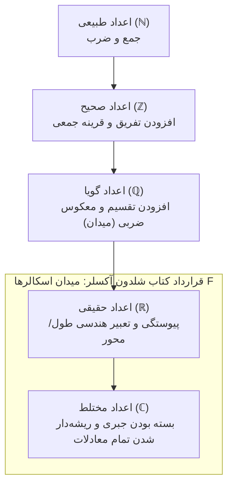

---
tags:
  - پیش‌نیاز
  - جبر_پایه
  - جبر_خطی
  - میدان
  - اسکالر
aliases:
  - میدان‌ها به زبان ساده (چرا نماد F)
---
# پیش‌نیاز: میدان‌ها به زبان ساده (چرا نماد F)

> [!TLDR] خلاصه شهودی در یک جمله
> «میدان» (Field) به زبان ساده یعنی یک زمین‌بازی عددی کامل که در آن هر چهار عمل اصلی ریاضی (جمع، تفریق، ضرب و تقسیم به جز تقسیم بر صفر) همیشه امکان‌پذیر و مجاز است؛ شلدون آکسلر از نماد اختصاری $\mathbb{F}$ استفاده می‌کند تا هر زمان قضیه‌ای برای هر دو دنیای اعداد حقیقی ($\mathbb{R}$) و اعداد مختلط ($\mathbb{C}$) برقرار بود، مجبور نباشد آن را دو بار بنویسد!

---

## ۱. انگیزه و ضرورت در جبر خطی
* **چرا این مفهوم را در کتاب آکسلر می‌بینیم و چرا اهمیت حیاتی دارد؟**
  اگر کتاب آکسلر را باز کنید، از صفحه ۱۲ تا آخرین صفحه کتاب با نماد $\mathbb{F}$ مواجه می‌شوید:
  $$V \text{is a vector space over } \mathbb{F}$$
  $$\mathbb{F}^n, \quad \mathcal{P}(\mathbb{F}), \quad \mathcal{L}(V, W)$$
  آکسلر در **نماد ۶.۱** کتاب صراحتاً قرارداد می‌کند:
  > *«در سرتاسر این کتاب، نماد $\mathbb{F}$ بیانگر $\mathbb{R}$ یا $\mathbb{C}$ خواهد بود.»*
  
  به اعضای $\mathbb{F}$ اصطلاحاً **اسکالر (Scalar)** یا عددهای مقیاس‌بخش می‌گویند. اگر ندانید چرا آکسلر به جای $\mathbb{R}$ از $\mathbb{F}$ استفاده می‌کند، دائم از خود می‌پرسید: «آیا $\mathbb{F}$ یک موجود جدید و عجیب است؟» خیر! $\mathbb{F}$ صرفاً یک متغیر مجموعه‌ای است که در هر لحظه می‌توانید آن را با $\mathbb{R}$ یا $\mathbb{C}$ جایگزین کنید.
* **مفاهیم متصل در کتاب:**
  - [[02-فصل اول - فضاهای برداری/01-فضاهای عددی (Rn و Cn)/نماد ۶.۱ میدان اسکالرها F|نماد ۶.۱: معرفی قرارداد F در آکسلر]]
  - [[02-فصل اول - فضاهای برداری/01-فضاهای عددی (Rn و Cn)/تعریف ۱۱.۱ فضای Fn و مختصات|تعریف ۱۱.۱: فضای Fn]]
  - [[02-فصل اول - فضاهای برداری/02-اصول موضوعه و تعریف فضای برداری/تعریف ۲۲.۱ فضای برداری حقیقی و مختلط|تعریف ۲۲.۱: تفکیک فضای حقیقی و مختلط]]
  - [[01-پیش‌نیازها و یادآوری دبیرستان/05-اعداد مختلط از صفر تا صد|پیش‌نیاز ۵: اعداد مختلط از صفر تا صد]]

---

## ۲. درک شهودی و تصویرسازی ذهنی

یک آشپزخانه را مجسم کنید که ۴ ابزار پخت‌وپز دارد:
1. مخلوط‌کن (جمع)
2. جداکننده (تفریق)
3. خردکن دوچندان (ضرب)
4. تقسیم‌کننده به قطعات مساوی (تقسیم)

- **اعداد طبیعی ($\mathbb{N}$):** اگر فقط با اعداد طبیعی $\{1, 2, 3, \dots\}$ کار کنید، حتی تفریق هم لنگ می‌زند! $2 - 5$ عددی طبیعی نیست. پس ابزار تفریق شما خراب است.
- **اعداد صحیح ($\mathbb{Z}$):** اعداد صحیح تفریق را حل می‌کنند ($\dots, -2, -1, 0, 1, \dots$). اما آیا می‌توانید تقسیم کنید؟ خیر! $3 \div 2 = 1.5$ عدد صحیح نیست. وارون ضربی برای عدد ۲ وجود ندارد ($\frac{1}{2} \notin \mathbb{Z}$).
- **میدان (Field):** سیستمی است که در آن هیچ بن‌بستی برای این ۴ عمل وجود ندارد! هر دو عضوی را بردارید، جمع، تفریق، ضرب و تقسیم کنید (مگر تقسیم بر صفر)، جواب مجدداً عضوی قانونی از همان سیستم است.

کلمه **Field** در انگلیسی یا **Körper** در آلمانی (به معنای پیکره/میدان) توسط ددکیند انتخاب شد، چون این مجموعه از نظر عملیاتی «کامل و خودکفا» است.

---

## ۳. تعریف دقیق و فرمول‌بندی ریاضی

> [!DEFINITION] تعریف رسمی میدان (Field)
> یک **میدان** که آن را با نماد $\mathbb{F}$ نشان می‌دهیم، مجموعه‌ای مجهز به دو عمل دوتایی جمع ($+$) و ضرب ($\cdot$) است که در ۱۰ اصل موضوعه زیر صدق می‌کند:
> ۱. **بستگی جمع و ضرب:** به ازای هر $a, b \in \mathbb{F}$، هم $a + b \in \mathbb{F}$ و هم $a \cdot b \in \mathbb{F}$.
> ۲. **جابه‌جایی:** $a + b = b + a$ و $a \cdot b = b \cdot a$.
> ۳. **شرکت‌پذیری:** $(a+b)+c = a+(b+c)$ و $(ab)c = a(bc)$.
> ۴. **وجود عضو خنثی جمع ($0$):** $a + 0 = a$.
> ۵. **وجود عضو خنثی ضرب ($1$):** $a \cdot 1 = a$ با شرط $1 \neq 0$.
> ۶. **وجود وارون جمعی ($-a$):** $a + (-a) = 0$.
> ۷. **وجود وارون ضربی ($a^{-1}$ یا $\frac{1}{a}$):** برای هر $a \neq 0$ عنصری هست که $a \cdot a^{-1} = 1$.
> ۸. **خاصیت توزیع‌پذیری:** $a(b + c) = ab + ac$.

> [!TIP] میدان‌های استاندارد در ریاضیات
> - $\mathbb{Q}$ (اعداد گویا): یک میدان است.
> - $\mathbb{R}$ (اعداد حقیقی): یک میدان است.
> - $\mathbb{C}$ (اعداد مختلط): یک میدان است.
> - **اما $\mathbb{Z}$ (اعداد صحیح) میدان نیست!** (چون وارون ضربی ندارد).

---

## ۴. چرا آکسلر جبر خطی را روی $\mathbb{F}$ بنا می‌کند؟

چرا به جای گفتن «فضای برداری حقیقی» یا «فضای برداری مختلط»، همه چیز را روی $\mathbb{F}$ می‌گوید؟

1. **صرفه‌جویی فوق‌العاده در اثبات‌ها:**
   تقریباً ۹۰٪ قضایای فصول ۱ تا ۴ آکسلر (مثل استقلال خطی، بعد، پایه‌ها، نگاشت‌های خطی) هیچ ربطی به این ندارند که اعداد شما حقیقی هستند یا مختلط! اگر آکسلر فقط با $\mathbb{R}$ پیش می‌رفت، مجبور بود کل کتاب را یک بار دیگر برای $\mathbb{C}$ تکرار کند.
2. **نیاز مبرم به اعداد مختلط در فصل‌های پایانی:**
   معادله $x^2 + 1 = 0$ هیچ ریشه حقیقی ندارد. در فصل ۵ (مقدارهای ویژه یا Eigenvalues)، برای اینکه عملگرها حتماً مقدار ویژه داشته باشند، باید ریشه‌های چندجمله‌ای وجود داشته باشند (قضیه اساسی جبر). از آنجا به بعد، آکسلر مشخصاً شرط می‌گذارد که $\mathbb{F} = \mathbb{C}$.

> [!EXAMPLE] مقایسه عملی: حل معادله در یک میدان در برابر اعداد صحیح
> **مسئله:** معادله $2x = 5$ را حل کنید.
> - در مجموعه اعداد صحیح $\mathbb{Z}$: این معادله **هیچ جوابی ندارد**؛ چون معکوس عدد ۲ یعنی $\frac{1}{2}$ در $\mathbb{Z}$ موجود نیست.
> - در میدان $\mathbb{R}$ یا $\mathbb{C}$: معکوس ۲ وجود دارد ($2^{-1} = 0.5$). دو طرف را در معکوس ضرب می‌کنیم:
>   $$x = 2^{-1} \cdot 5 = \frac{5}{2} = 2.5$$
> *نتیجه در جبر خطی:* در اثبات استقلال خطی، وقتی داریم $c_1 v_1 + c_2 v_2 = 0$ و فرض کنیم $c_1 \neq 0$ باشد، در میدان می‌توانیم دو طرف را بر $c_1$ تقسیم کنیم:
> $$v_1 = -\frac{c_2}{c_1} v_2$$
> این کار فقط و فقط به این دلیل ممکن است که اسکالرها عضو یک **میدان ($\mathbb{F}$)** هستند!

---

## ۵. خطاهای رایج و دام‌های مفهومی

> [!WARNING] اشتباهات متداول درباره میدان $\mathbb{F}$
> - **اشتباه ۱: تصور اینکه $\mathbb{F}$ یک مجموعه جدید از اعداد است:**
>   $\mathbb{F}$ یک مجموعه سوم در کنار $\mathbb{R}$ و $\mathbb{C}$ نیست! $\mathbb{F}$ نام مستعار برای یکی از این دو است. هر زمان نماد $\mathbb{F}$ را دیدید، در ذهن خود بخوانید: «اعداد حقیقی یا اعداد مختلط».
> - **اشتباه ۲: فرض اینکه اسکالرها می‌توانند عدد صحیح باشند:**
>   اگر کسی بگوید ضرایب ترکیب خطی اعداد صحیح هستند، ساختار حاصل دیگر فضای برداری نیست (به آن در ریاضیات پیشرفته «مدول» یا Module می‌گویند). در جبر خطی همیشه اسکالرها از یک میدان می‌آیند تا بتوان در صورت لزوم تقسیم انجام داد.

---

## ۶. پیوندها و گام بعدی
- **پیش‌نیاز قبلی:** [[01-پیش‌نیازها و یادآوری دبیرستان/03-اعداد حقیقی و اصول جبری|پیش‌نیاز ۳: اعداد حقیقی و اصول جبری]]
- **پیش‌نیاز بعدی:** [[01-پیش‌نیازها و یادآوری دبیرستان/05-اعداد مختلط از صفر تا صد|پیش‌نیاز ۵: اعداد مختلط از صفر تا صد]]
- **کاربرد در فصل‌های آکسلر:**
  - [[02-فصل اول - فضاهای برداری/01-فضاهای عددی (Rn و Cn)/نماد ۶.۱ میدان اسکالرها F|نماد ۶.۱: تعریف رسمی نماد F]]
  - [[02-فصل اول - فضاهای برداری/01-فضاهای عددی (Rn و Cn)/تعریف ۱۱.۱ فضای Fn و مختصات|تعریف ۱۱.۱: تعریف فضای مختصاتی Fn]]
- **بازگشت به نقشه راه:** [[00-نقشه‌های راه/01-MOC پیش‌نیازهای ریاضی|MOC پیش‌نیازهای ریاضی]]
